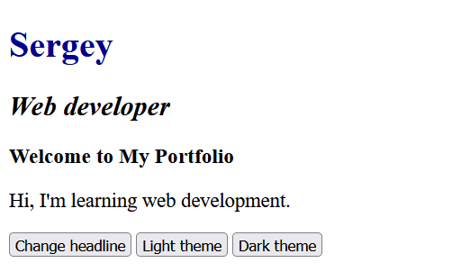
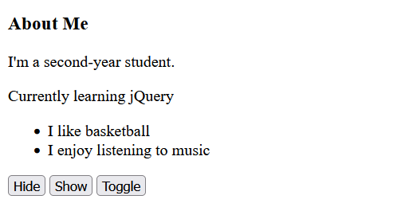
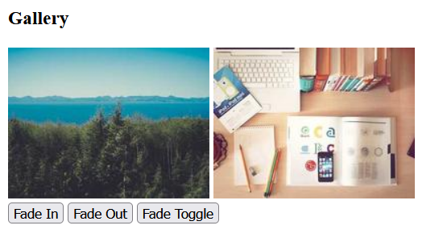
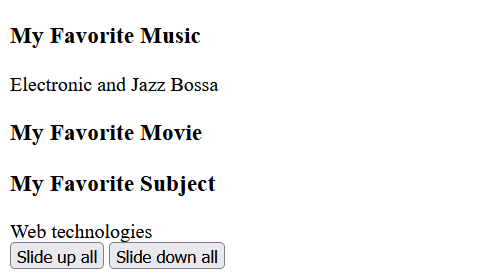
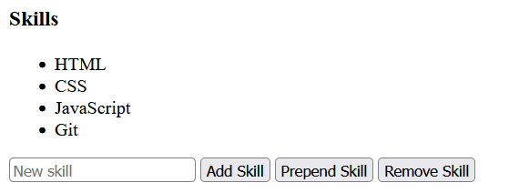
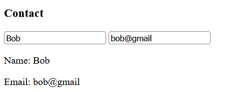
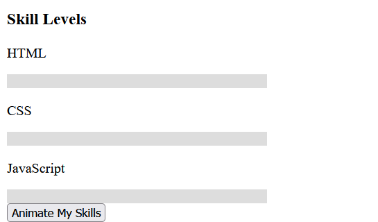

# Assignment 6: jQuery Portfolio

**Name:** Sergey
**Group:** SE-2540
**Repo:**
**GitHub Pages:**

## Part 1. Getting Started with jQuery

### Task 0. Setup

Include jQuery from a CDN, use `$(document).ready()`, and print "jQuery is ready!" in the console.

### Task 1. Selectors & CSS

Name, headline, intro, tag/ID/class selectors, `.text()`/`.html()`, `.css()`, light/dark theme buttons.

## Part 2. jQuery Effects

### Task 2. Visibility Methods

About Me section with Hide, Show, and Toggle buttons.

### Task 3. Fade Methods

Two images controlled with `.fadeIn()`, `.fadeOut()`, `.fadeToggle()`.

### Task 4. Slide Methods

Three clickable headings with collapsible panels using `.slideUp()`, `.slideDown()`, `.slideToggle()`.

## Part 3. DOM Manipulation with jQuery

### Task 5. Add & Remove Elements

Skill list with `.append()`, `.prepend()`, `.remove()` and an empty input check.

### Task 6. Modifying Attributes

A button changes the link's `href` with `.attr()`.

### Task 7. Form Interaction

Name and email shown live with `.val()` and `.text()`.

## Part 4. Animations

### Task 8. Basic Animation

Skill bars start at 0 width and are animated with `.animate()` to different widths. A second click animates them back to 0.

## Summary

I built the portfolio task by task in one page and committed after each task.
